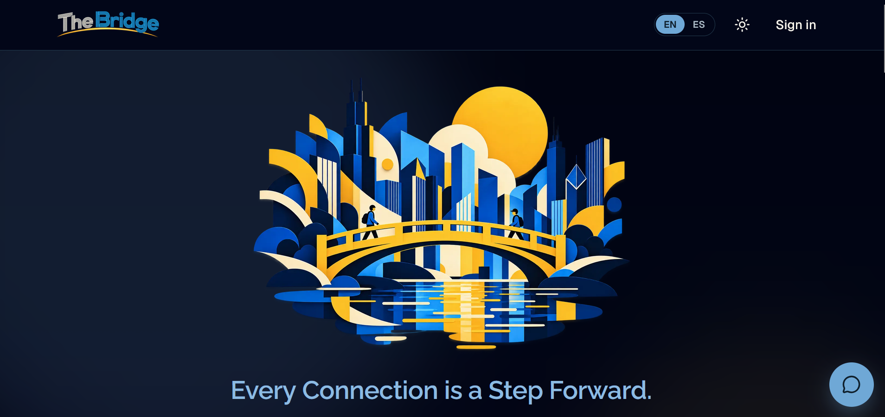

# The Bridge

<p align="center">
  
</p>

**Bridging the gap. Ending homelessness.**

**Live site:** https://the-bridge-one.vercel.app/

The Bridge is a Chicago-focused platform where outreach workers and community members share needs and approved organizations coordinate help. Needs can include housing resources, identification and vital documents, employment, education, healthcare, transportation, essential supplies, legal assistance, reentry support, and community services. The Bridge connects people and organizations; it does not provide these services itself. Privacy and dignity guide the way requests are shared.

## Mission

Bridging the gap between people experiencing homelessness and the community organizations ready to help. The Bridge starts with essential resources and outreach, builds trust through consistent contact, and grows toward the services people need to find stability: medical care, documents, benefits, addiction and mental health support, employment, education, and housing. People experiencing homelessness don't use the app themselves; the outreach workers and community members who support them post what's needed, and organizations respond.

## Features

| Feature | What it does |
|---|---|
| Post a Need | Outreach workers and community members describe what's needed: the type of support, the items, how many people, the neighborhood, notes, and a time window. |
| Privacy screening | A server-side deterministic check and Claude Haiku classify request text before posting. Clear risks are returned for revision; uncertain requests wait in a private admin queue. Screening outages do not publish. |
| Organization accounts | Organizations sign up with their name, website, an optional EIN, and a contact. A person reviews each one before it can claim needs or see contact information. |
| Needs Board and need pages | Organizations browse open and in-progress needs as sticky notes (`/board`); each need has its own page with a status timeline (`/requests/[id]`). |
| Claim, fulfil, cancel | An approved organization claims a need; the poster marks it fulfilled or cancels it while it's open. The rules are enforced on the server and in the database, including when two organizations claim at the same moment. |
| Dashboard and Inbox | Role-specific dashboard actions and impact counts, plus a dedicated `/inbox` for claim, fulfillment, account, and review notifications. The header shows unread notifications. |
| Admin review | Admins review organization applications, approve, reject, or revoke, with an internal note (`/admin`). |
| Admin privacy review | Admins review separately screened safe drafts at `/admin/privacy`; approval screens the exact candidate again. Submitters see the review status on their dashboard. |
| AI assistant | A chat assistant that explains The Bridge and helps people think through resources and next steps, with guardrails (see below). |
| English and Spanish | An EN / ES switch in the header; the choice is saved in a `lang` cookie and the page renders on the server in that language. |
| Light and dark themes | A theme toggle in the header (dark by default). |
| Accessibility | Responsive down to 320px, keyboard and screen-reader support, 44px tap targets, contrast checked from real pixels, reduced motion respected. |

The Spanish copy has been reviewed and verified by two fluent Spanish speakers.

## How It Works

**1. Request**

Anyone in the community can share a need.

**2. Connect**

People and organizations come together to help.

**3. Provide**

Help, resources, and information reach those who need them.

**4. Support**

Ongoing connections create pathways to housing and essential services.

**5. Transform**

Communities work together toward ending homelessness.

## Tech stack

- **Next.js** (App Router, Cache Components), **React**, **TypeScript**
- **Tailwind CSS**, **shadcn/ui** (Radix UI), **Motion**
- **PostgreSQL on Neon**, with **Drizzle ORM** and Drizzle Kit migrations
- **Neon Auth** for sign-in
- **Anthropic API** (Claude Haiku) for the assistant and privacy screening
- **Vercel** for hosting

## Privacy and safety design

- **What's stored about a need:** the Chicago community area (a neighborhood, not an address), the number of people, the type of support, the items needed, optional notes, and a time window.
- **Before publication:** items and notes receive deterministic checks and server-side Anthropic screening. Medium-risk original text is not stored in the review queue; only a separately screened safe candidate and category labels are kept. High-risk text and failed screenings are not saved as needs. Published needs carry a boolean screening flag and category names, not model output.
- **Risk levels:** low-risk requests follow the normal publication flow; medium-risk requests wait privately for admin review of a safe draft; high-risk requests are blocked with guidance and may be revised. A suggested rewrite can fill the description for the poster to review and submit again. Admin approval screens the exact final draft again. Revised submissions keep their prior review history.
- **Location policy:** screening checks exact addresses, unit identifiers, GPS coordinates, and details that identify vulnerable people or precise sheltering locations. General neighborhood and geographic descriptions are permitted.
- **Needs-screening data flow:** only when the local scan finds no recognized sensitive pattern, the server sends the locally scanned items, notes, and community area to Anthropic; it never sends account details. If the local scan finds a pattern, it blocks the submission before the provider call. [Anthropic's API retention policy](https://privacy.anthropic.com/en/articles/7996866-how-long-do-you-store-my-organization-s-data) says inputs and outputs are ordinarily deleted within 30 days, with stated exceptions. The app does not retain the screening prompt or response.
- **Identifying details are not requested:** the schema has no dedicated fields for names, addresses, or exact locations of people being served. Screening checks free text before publication, but automated classification cannot guarantee that every sensitive detail is caught.
- **Contact information** (account emails) is shared only between the person who posted a need and the organization that claimed it, only after the claim, and only while that organization is approved. Which emails a page may show is decided in the database queries, so a hidden email is never sent to the browser.
- **Pages only some accounts may see** (the Needs Board, need pages, admin) answer everyone else with the same not-found page and a real 404, so they don't reveal that they exist.
- **Passwords** are handled by the managed auth service (Neon Auth), which stores them hashed; the app never stores or logs them.
- **The assistant** has no access to accounts, requests, or the database, and never sends email. The conversation is held in browser component memory and resets when the page reloads. When `ANTHROPIC_API_KEY` is configured, each chat request sends the submitted user and assistant message history to `/api/chat`, which forwards that history to Anthropic; without the key, the route returns a fixed fallback. Chat text is not stored in the app database or written to application logs. Unlike the Post a Need flow, chat has no local PII screening, so do not enter names, contact details, health information, or exact locations. The assistant's instructions not to request or repeat sensitive details are model guidance, not a technical filter. The panel displays 988 crisis guidance, and the assistant is instructed to point people to 988 or 211 when appropriate; there is no deterministic server-side crisis-response path. Anthropic's API retention policy linked above applies to chat content too.
- **Secrets** are kept out of the repository (only `.env.example`, without values, is committed) and out of logs: every script filters its output through `src/lib/redact.ts`.

## Getting started (local development)

### Prerequisites

- **Node.js 22.18 or later** (the repo's scripts run TypeScript files directly with Node; development uses Node 24). The repo doesn't pin a version in `package.json` or `.nvmrc`.
- **npm**
- **A Neon account**, with a separate development database and Neon Auth enabled. Do not point local development or test scripts at production.

### Install

```sh
npm install
```

### Environment variables

Copy `.env.example` to `.env.local` and fill in the values. Never commit `.env.local` or `.env.prod.local`.

| Variable | What it does | Local development | Production |
|---|---|---|---|
| `DATABASE_URL` | Postgres connection string for the Neon database | Required (the development project) | Required (set in Vercel) |
| `NEON_AUTH_BASE_URL` | The Neon Auth endpoint for sign-in | Required | Required |
| `NEON_AUTH_COOKIE_SECRET` | Signs the session cookies (at least 32 characters) | Required | Required |
| `ANTHROPIC_API_KEY` | Server-side assistant and privacy screening key; without it, the assistant uses a fixed fallback and new requests cannot pass screening | Required to post needs | Required to post needs |
| `ADMIN_CONTACT_EMAIL` | The address shown to organizations under review or not approved (banners, inbox, assistant) | Optional | Recommended |
| `SEED_TEST_PASSWORD` | The password for the seeded test accounts, used by `db:seed` and the browser tests | Required for seeding and tests | Not used |
| `E2E_BASE_URL` | The local server the browser tests use (default `http://localhost:3100`) | Optional | Not used |
| `CHROME_PATH` | Where the browser tests find Chrome, if not in its usual place | Optional | Not used |

`.env.example` lists the first four. Production's database URL also lives in `.env.prod.local` (never committed), which only `db:migrate:prod` and `admin:grant:prod` read. Don't name it `.env.production.local`: Next.js loads that file automatically in production mode and it would override `.env.local`.

### Database

```sh
npm run db:migrate   # apply the migrations in drizzle/ to the database in .env.local
npm run db:seed      # create or reset the test accounts and test needs (development only)
```

The seed creates fictional accounts (for example `test.outreach1@example.com`, `test.donor1@example.com`, and the admin `test.admin@example.com`), all with the password in `SEED_TEST_PASSWORD`. It checks the development database target before running (`src/db/dev-guard.ts`).

### Run

```sh
npm run dev
```

Then open http://localhost:3000.

## Scripts

"Database" says which database a script touches; "development only" scripts check first and refuse any other database.

| Script | What it does | Database |
|---|---|---|
| `dev` | Starts the development server at http://localhost:3000 | Reads the database in `.env.local` |
| `build` | Builds the app for production | None |
| `start` | Serves the production build | Reads the database in `.env.local` |
| `lint` | Runs ESLint | None |
| `db:generate` | Creates a new migration in `drizzle/` from changes to `src/db/schema.ts` | None |
| `db:migrate` | Applies pending migrations | Writes to the database in `.env.local` |
| `db:seed` | Creates or resets the test accounts, needs, and notifications | Development only |
| `test:claims` | Tests the request, verification, and inbox rules (see Testing) | Development only; deletes only the rows it created |
| `test:privacy-rules` | Tests privacy classification and admin review rules with synthetic data and mocked AI responses | Development only; cleans up its own rows |
| `test:privacy-screening-boundary` | Offline checks for local redaction, the sanitized Anthropic payload, and blocked-content boundaries | None |
| `test:assistant-reply` | Tests how assistant replies are cleaned up | None |
| `test:assistant-scope` | Checks assistant topic coverage without calling Anthropic | None |
| `test:redact` | Tests that scripts never print secrets | None |
| `test:migrate-summary` | Tests the production migration script's summary, against development | Development only |
| `admin:grant` | Makes an existing account an admin: `npm run admin:grant -- <email>` | Writes to the database in `.env.local` |
| `admin:grant:prod` | **Production.** The same on production; reads `.env.prod.local` and changes nothing unless you type `yes` | **Production** |
| `db:migrate:prod` | **Production.** Applies migrations to production; runs only with `-- --confirm` | **Production** |
| `e2e` | Runs every browser test suite | Development only; reseeds |
| `e2e:<suite>` | Runs one browser test suite (see Testing) | Development only; reseeds |

## Testing

### Rule and unit tests

```sh
npm run test:claims            # request, verification and inbox rules (development database)
npm run test:privacy-rules      # privacy screening and admin review rules (development database)
npm run test:privacy-screening-boundary # offline local-screening and Anthropic payload checks
npm run test:assistant-reply   # assistant reply clean-up
npm run test:assistant-scope   # assistant topics (offline)
npm run test:redact            # secrets never appear in script output
npm run test:migrate-summary   # the production migration script's summary (development database)
```

`test:claims` calls the same rule functions as the app (`src/lib/request-rules.ts`) with the seeded accounts. It covers claiming, fulfilling, and cancelling; organization approval, rejection, and revocation; which emails each side can see; the Needs Board and need-page visibility; that each change creates exactly one notification (including a race of two organizations claiming at once, 10 times); and that people can read only their own notifications. It deletes only the rows it created and writes its results to [docs/test-results.md](docs/test-results.md). `test:privacy-screening-boundary` is offline: it calls the production screening functions with synthetic text and mocked classifiers, and checks that detected content is blocked before an Anthropic payload can be made. It does not use a database or call Anthropic. `test:assistant-scope` checks the assistant's supported topics without calling Anthropic.

### Browser tests

The suites in `scripts/e2e/` drive headless Chrome against a local production build. They run only against the development database and a localhost server: they refuse anything else, and reseed the test data before and after each suite. They need Chrome installed (or `CHROME_PATH`).

```sh
npm run build
npx next start -p 3100   # in another terminal
npm run e2e              # every suite, or one: npm run e2e:board
```

| Suite | Covers |
|---|---|
| `e2e:responsive` | Layout of the main pages at phone to desktop widths |
| `e2e:dashboards` | Sign-in forms and the pending, rejected, and approved organization dashboards |
| `e2e:admin` | The admin review page, its tabs and confirmations |
| `e2e:contact` | Who sees which contact email, before and after a claim |
| `e2e:nav` | Header links, phone menu, language switch, focus, 44px targets |
| `e2e:verification` | Admin access (a real 404 for others), approving and revoking |
| `e2e:form` | The Post a Need privacy notice and layout |
| `e2e:dropdown` | Post a Need dropdown colors and contrast |
| `e2e:panel` | The assistant panel: layout, keyboard, contrast, limits |
| `e2e:notices` | Contrast of the account-status banners and notices |
| `e2e:homepage` | The homepage hero, images, buttons, and reduced motion |
| `e2e:signin` | The sign-in page, tabs, account types, and errors |
| `e2e:a11y` | Every page for each kind of account: contrast, headings, landmarks, names, no overflow |
| `e2e:board` | Needs Board and need-page access for every account, the sticky notes, the inbox |
| `e2e:spanish` | The language switch and cookie, Spanish pages with no English left, Spanish layout |
| `e2e:not-found` | The not-found page with JavaScript off, in both languages |

Add `-- --lang=es` to run a suite with the Spanish cookie. More options are in [scripts/e2e/README.md](scripts/e2e/README.md).

### Reports

- [docs/test-results.md](docs/test-results.md): the latest `test:claims` results
- [docs/assistant-tests.md](docs/assistant-tests.md): assistant conversation tests
- [docs/responsive-audit.md](docs/responsive-audit.md): the responsive layout audit
- [docs/design-system.md](docs/design-system.md): the design system and its decisions
- [docs/privacy-screening.md](docs/privacy-screening.md): Post a Need privacy screening data flow and detection limits
- [docs/security-notes.md](docs/security-notes.md): reviewed security advisories

## Project structure

```
src/
  app/          Pages (under [lang]/, one set per language), API routes, global styles
  components/   Shared components (header, request cards, sticky notes, assistant, ui/)
  lib/          Rules, copy, language, validation, auth helpers
  db/           Database schema, connection, seed, and the development-only guard
  proxy.ts      Picks the language and protects pages before they render
drizzle/        SQL migrations and their snapshots
scripts/        Test scripts, admin and production scripts; e2e/ holds the browser tests
docs/           Test results, audits, design system, privacy screening, security notes
public/         Images and brand assets
design/source/  The original logo artwork
```

- **The rules:** `src/lib/request-rules.ts` holds every permission check (who can post, claim, fulfil, cancel, review, and see what). Pages call these functions; they're never enforced in the interface alone.
- **The assistant's instructions:** `src/lib/assistant-prompt.ts`, with its settings in `src/lib/assistant-config.ts`.
- **The copy:** `src/lib/copy.ts` holds every string people see, in English and Spanish.

## Deployment

- **Hosting:** pushes to the `main` branch deploy to Vercel.
- **Source:** [GitHub repository](https://github.com/kendrahartnett/the-bridge). The production deployment follows GitHub `main`; pushing code does not run database migrations.
- **Environment variables in production** (names only): `DATABASE_URL`, `NEON_AUTH_BASE_URL`, `NEON_AUTH_COOKIE_SECRET`, `ANTHROPIC_API_KEY`, `ADMIN_CONTACT_EMAIL`.
- **Separate databases:** use a dedicated development Neon database and Neon Auth configuration for local work and tests. The former development branch was removed; provision and verify a new development target before running database-writing development commands.
- **Migrations:** test a migration on development first (`npm run db:migrate`), then apply it to production:

  ```sh
  npm run db:migrate:prod -- --confirm
  ```

  It reads production's database URL from `.env.prod.local`, refuses to run without `--confirm`, and reports which migrations were applied and how many are recorded.

  Before pushing code that depends on a new schema, verify a production recovery point, apply and verify the migrations on the active production database, then confirm the Vercel deployment and public pages load. Keep development commands pointed at a separate development database.

## Known limitations

- **Chat rate limits are per server instance:** the assistant allows 20 requests per IP per hour, counted in each server instance's memory, so on Vercel it isn't exact across the whole site.
- **Neon Auth is in beta** (`@neondatabase/auth` 0.7.0-beta).
- **No real-time updates:** notifications and the Needs Board update when the page loads.
- **The assistant's 10-question limit resets** when the page is refreshed. Conversation history is supplied by the browser on each request; the API checks the submitted history's shape and question count but has no server-side session state to verify its integrity or preserve the count across refreshes or direct API calls. Client-supplied assistant messages are not authenticated as replies previously generated by the app.
- **The theme needs JavaScript:** without it, pages show the light theme.
- **No text messages or email alerts yet.**
- **Organization verification is manual,** so approval depends on an admin reviewing applications.
- **Privacy screening can miss details or flag harmless text.** This screening applies to Post a Need submissions, not chat messages. The admin queue only receives a separately screened safe candidate; admins re-screen it before approval.
- **No maps or location-based features yet.**
- **The illustrations are AI-generated** and illustrative; they don't show real people or events.

## Roadmap

- Phone and text contact options on posts, and a completion note.
- Email alerts for new organization applications and claims.
- Automated EIN verification.
- A neighborhood map showing needs by area, without exact locations.
- Filters on the Needs Board.
- A step where the organization confirms receipt.

## Contributing and feedback

To report a problem or suggest an improvement, open an issue at https://github.com/kendrahartnett/the-bridge/issues. Please don't include anyone's personal details in an issue.

The Bridge is used by real people. Any change must keep the privacy rules above (nothing identifying about the people being served, contact information only where the rules allow) and keep every test passing: `npm run lint`, `npm run build`, `npm run test:claims`, and `npm run e2e`.

## Acknowledgments

- The homepage and not-found illustrations and the logo artwork are AI-generated.
- Built with open-source software: Next.js, React, TypeScript, Tailwind CSS, shadcn/ui, Radix UI, Motion, Drizzle ORM, Zod, React Hook Form, next-themes, Sonner, Lucide, and the Anthropic and Neon SDKs.
- Two button designs are adapted from Uiverse.io (by ShrinilDhorda and by barisdogansutcu).

## License

To be added by the author.

## Author & AI Development

**Created and developed by:** Kendra Anne Hartnett

**AI-assisted development tools:** Anthropic Claude Code and OpenAI Codex.

AI coding tools supported implementation, debugging, testing, and iteration. Project direction, requirements, design decisions, and verification remained human-led.
